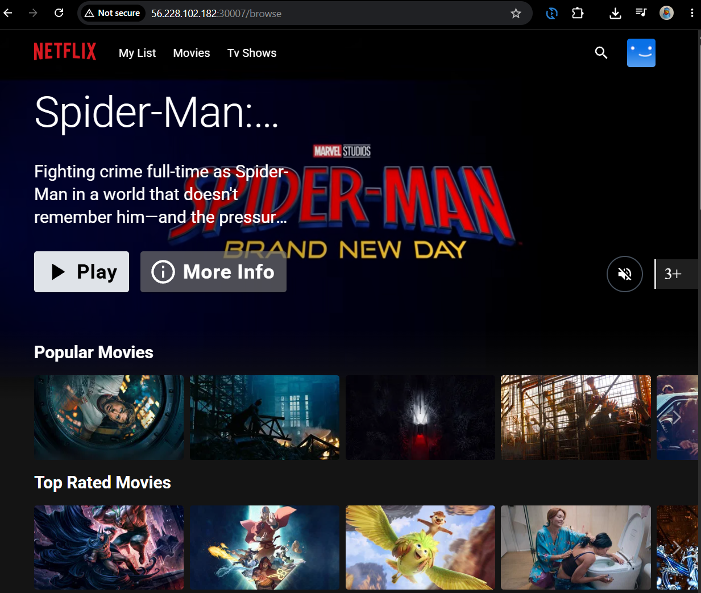
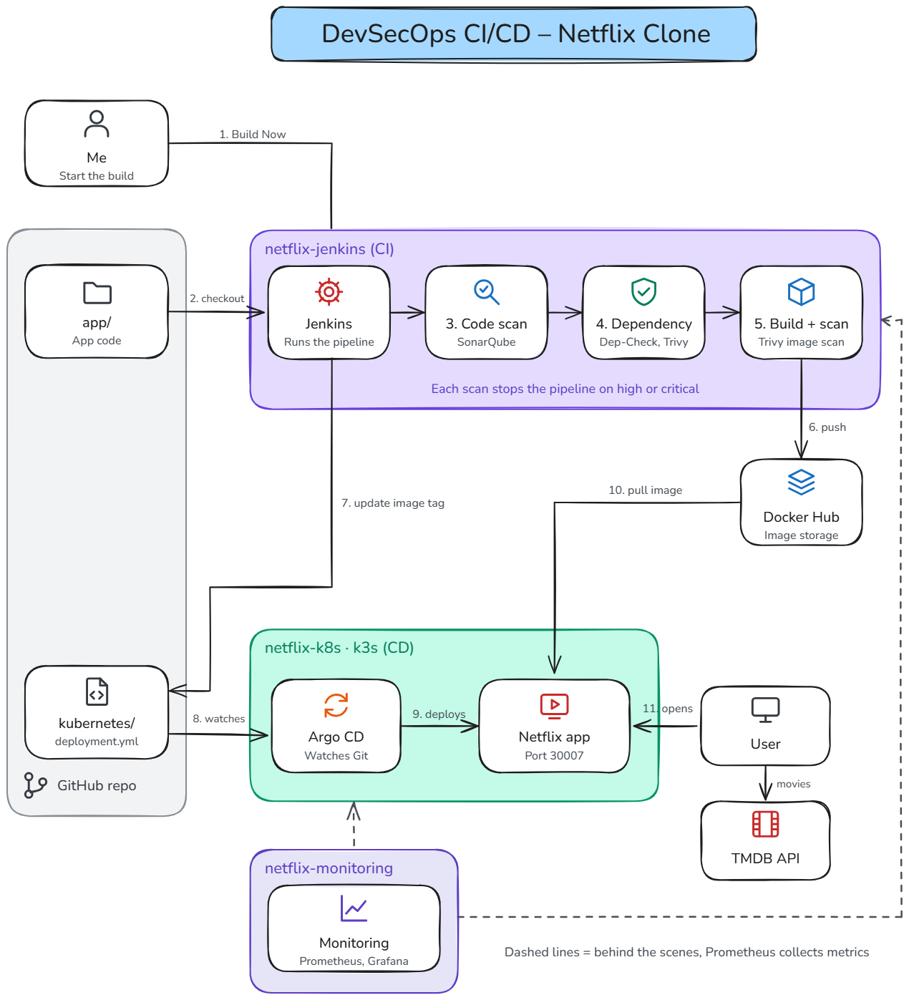
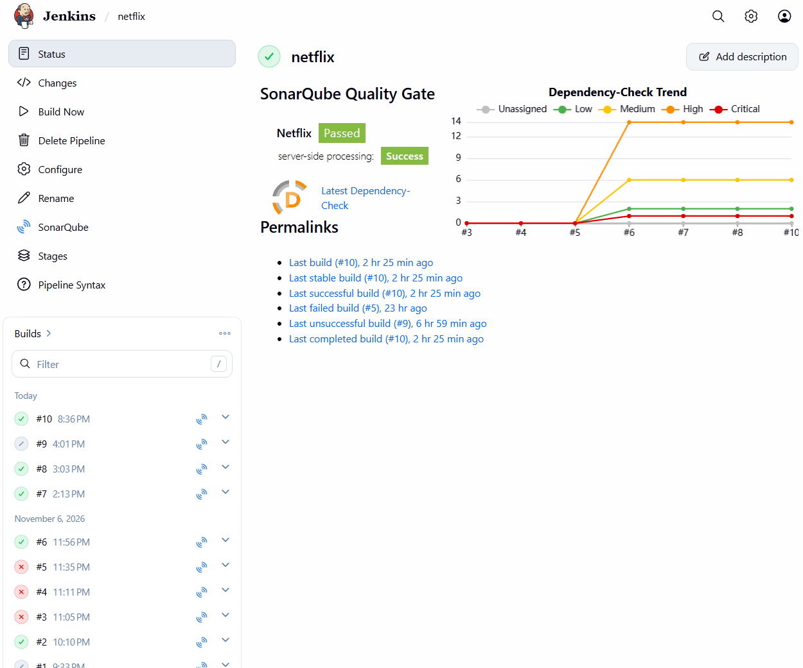
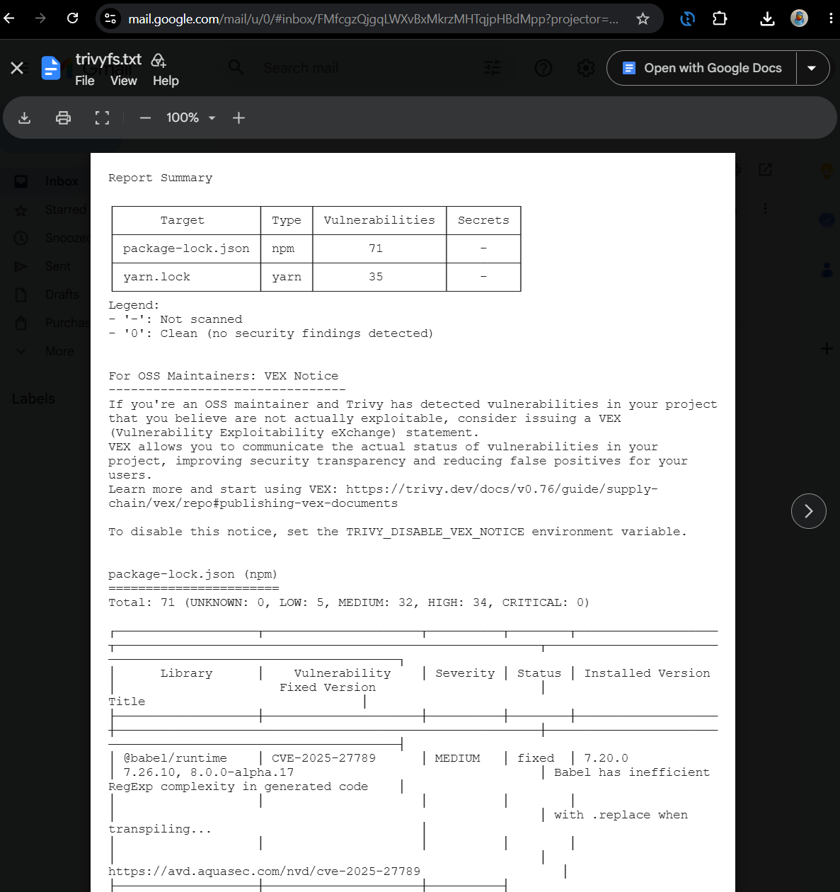
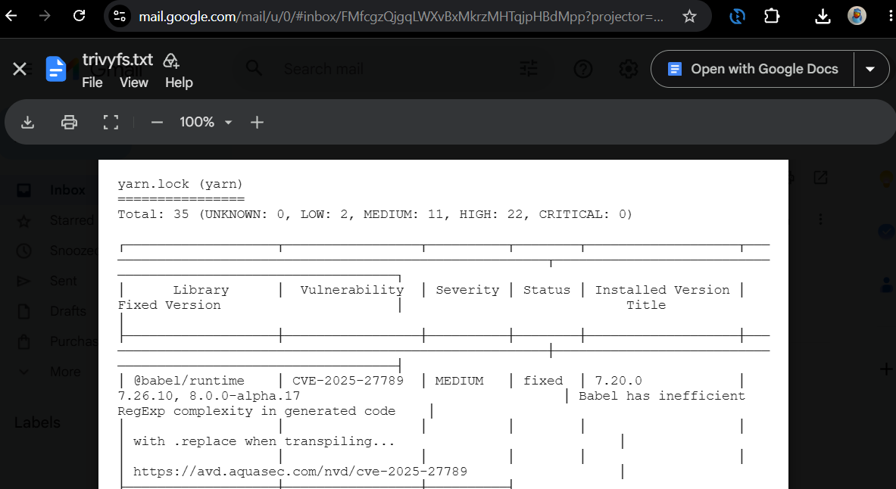
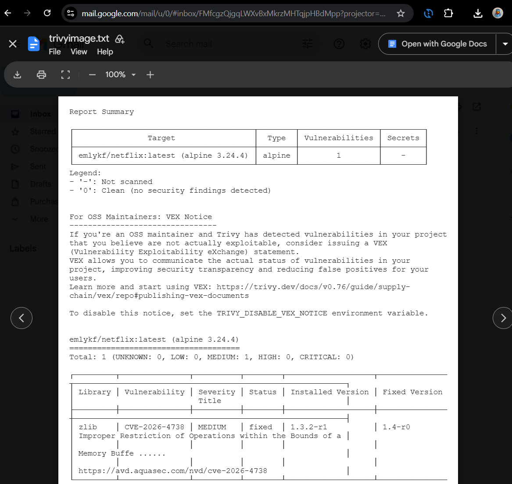
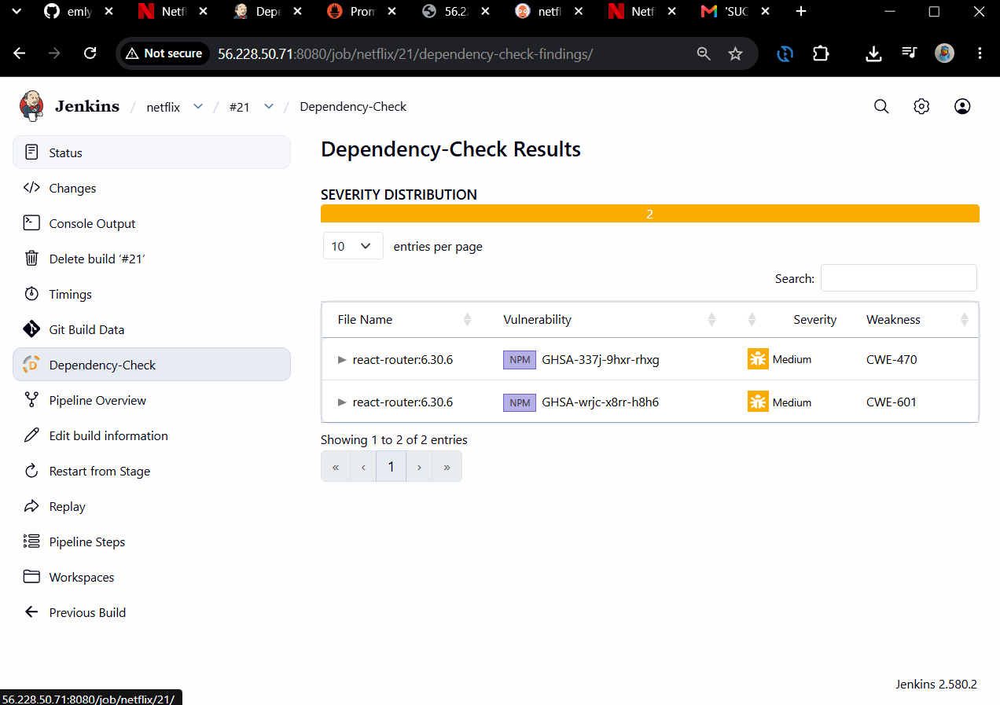
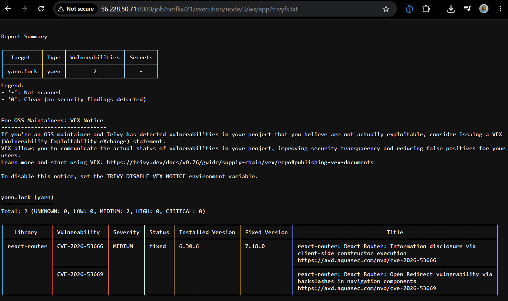
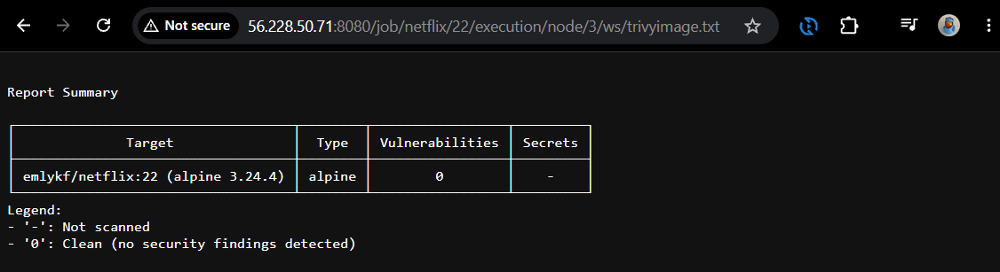
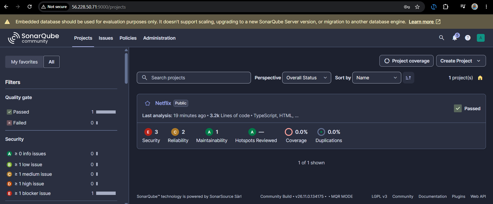

# DevSecOps CI/CD – Netflix Clone

A Netflix clone that checks itself for security problems before it goes live. Every new version is scanned, built into a Docker image and deployed to Kubernetes automatically.

**Built with:** Jenkins, SonarQube, OWASP Dependency-Check, Trivy, Docker, Argo CD, k3s, Prometheus, Grafana, AWS EC2

Based on Cloud Champ's Netflix DevSecOps tutorial. I changed the pipeline so it stops if there are any big security problems and fixed all the important issues (from 1 critical and 14 high to zero). Now, the app is actually safe before it goes live.

 

## Notes

- **Why a separate monitoring server?** – Prometheus collects build data from Jenkins and CPU, memory and disk usage from the Kubernetes server and the monitoring server itself. Grafana shows it in dashboards. It runs on its own server, so I can still see what's happening even if the Jenkins server is overloaded.
- **Why k3s?** – it's a lightweight Kubernetes that runs on a single EC2, which is enough for a demo and cheaper than a managed cluster. In production, I'd use a managed cluster like EKS.
- **Why doesn't the trailer play?** – the original app uses a demo video stream that is blocked now. The rest of the app works.

## Security Hardening

<b>Screenshots before the hardening</b>

<b>Screenshots after the hardening</b>

 

**What I changed:**

- **Security groups:** every port is only open to my IP, plus the exact servers that need it (for example, Prometheus can reach Jenkins, but nobody else can).
- **Secrets:** the TMDB key, NVD key and GitHub token are stored as Jenkins credentials and hidden in the logs. The GitHub token only has access to this repo and expires after 30 days.
- **Dependencies:** switched to Yarn only (one lock file), upgraded Node 16 to Node 26 LTS, and updated the vulnerable packages.
- **Gates:** the pipeline now stops if the Quality Gate fails, or if Dependency-Check or Trivy find high or critical vulnerabilities. The image is scanned before it gets pushed to Docker Hub.
- **Base image:** the final image updates its Alpine packages during the build, so it gets the latest security fixes.
- **Deployment:** Cloud Champ's version ran the app twice: as a container on the Jenkins server and on Kubernetes. I removed the container on the Jenkins server, so the app now only runs on k3s. Every image gets the build number as its tag, Jenkins updates `deployment.yml` in Git, and Argo CD deploys it.

**Results:**

- **Dependency-Check:** 1 critical and 14 high findings before, 2 medium after.
- **Trivy (code):** 56 high findings before (34 in `package-lock.json` and 22 in `yarn.lock`), 2 medium after. Both are in React Router and only fixed in version 7.
- **Trivy (image):** 1 medium before, 0 after.
- **SonarQube:** the same 3 security findings before and after. All 3 are in the Dockerfile: two because the TMDB key is passed into the build, and one because nginx runs as root. Moving the key in the Dockerfile wouldn't make it safer, because the app puts it into the frontend JavaScript anyway. The real fixes are listed below under next improvements.

## What I Would Improve Next?

- **Kubernetes:** a managed cluster like EKS instead of k3s on one EC2, and a Helm chart instead of plain manifests.
- **App updates:** upgrade to React Router 7 (fixes the last 2 findings) and update the build tools (Vite 3).
- **TMDB key:** the key ends up in the frontend JavaScript. A small backend should call TMDB, so the key never reaches the browser.
- **nginx:** run as a non-root user.
- **Monitoring:** turn off Prometheus's lifecycle API, protect Jenkins's `/prometheus` endpoint with a login, and scrape over private IPs.
- **Argo CD:** pin a fixed version and use a real certificate instead of the self-signed one.
- **Jenkins:** load the pipeline from Git (Pipeline from SCM), add a secret to the SonarQube webhook, and check sha256 checksums when installing tools.
- **AWS:** encrypt the EBS volumes.

## 📝 Credit

Based on the DevSecOps project by @N4si. Security hardening, k3s setup and fixes by me.

This product uses the TMDB API but is not endorsed or certified by TMDB.